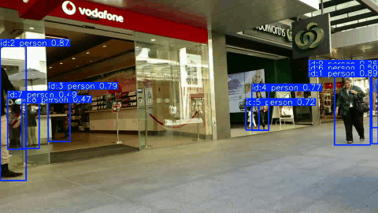

# 行人检测、跟踪与 ONNX 后端评测

基于 YOLO11s、ByteTrack 和 TrackEval 的视觉工程项目，包含 CrowdHuman 数据转换与微调、视频跟踪、MOT 轨迹导出、配置校验，以及 PyTorch / ONNX Runtime CUDA 的受控对照。



**个人实现范围**：数据清洗/转换、命令行入口、逐帧轨迹输出、运行配置快照、坐标映射、评估集成和基准计时。YOLO、ByteTrack、TrackEval 的算法与预训练模型来自上游项目，不作为自行提出的新算法。

## 已完成的工程链路

```text
CrowdHuman → 标签转换 → YOLO11s 微调
                              ↓
视频 + 权重 + tracker YAML → 跟踪视频 / MOT轨迹 / 配置快照
                              ↓
                输入校验 → GT坐标映射 → TrackEval

PT权重 → FP32 ONNX → 相同输入/后处理 → 时延与跟踪效果对照
```

- 跟踪入口同时支持 PT / ONNX，默认不弹窗，可使用 `--show`。
- 四组 ByteTrack 配置独立保存，不反复修改上游 YAML。
- 每次运行保存视频、轨迹、实际配置和版本记录；空检测帧保留在视频中。
- 评估输入检查重复 ID、帧数、视频尺寸和坐标约定，并保存轨迹哈希与 GT 对齐图。
- 独立检查脚本校验实验控制变量及轨迹实际行数。
- RGB-D 几何练习作为附加模块保留，见 [RGB-D 说明](docs/RGBD.md)。

## 环境

已运行环境：Python 3.10.21、PyTorch 2.5.1+cu121、TorchVision 0.20.1、Ultralytics 8.3.185、NumPy 1.26.4、OpenCV 4.9.0.80、ORT GPU 1.20.2。

仓库保留 `ultralytics/` 源码以维持当前运行行为，使用 editable 安装，不再同时要求安装另一个同名 PyPI 包。CPU 与 GPU 的 ORT 依赖二选一。

GPU 示例（在仓库根目录执行；可跳过已有环境的安装）：

```powershell
conda create -n pedestrian_tracking python=3.10 -y
conda activate pedestrian_tracking
python -m pip install torch==2.5.1 torchvision==0.20.1 --index-url https://download.pytorch.org/whl/cu121
python -m pip install -e .
python -m pip install -r requirements-onnx-gpu.txt
```

只用 PT 跟踪时安装 `requirements.txt` 即可。CPU ONNX 环境使用 `requirements-onnx-cpu.txt`，不要与 GPU 版本安装在同一环境。CPU 路线未做本项目性能基准；全新机器的完整安装未重新验证。

## 快速运行

先准备一个视频。使用官方预训练模型可检查程序入口：

```powershell
python -c "from ultralytics import YOLO; YOLO('yolo11s.pt')"
python track_crowdhuman.py --model yolo11s.pt --source data/videos/A_street.mp4 --tracker configs/trackers/baseline.yaml --output runs/demo --device 0
```

把 `--source` 换成你自己的视频也可运行。**此演示模型不是下方指标所用的 CrowdHuman 微调权重**；指标复现需要相应权重与输入协议，见 [数据和权重](docs/DATA_AND_WEIGHTS.md)。

每次输出：

```text
runs/demo/
├── tracked.mp4
├── tracks.txt
├── tracker.yaml
└── run_config.json
```

`tracks.txt` 为十列 MOT 格式：帧号、ID、left、top、width、height、confidence、-1、-1、-1。坐标使用输入视频像素，左上角从 1 开始。保存了轨迹不表示它已与 GT 尺度一致。

## 数据准备与训练

CrowdHuman 原始目录应包含 `annotation_train.odgt`、`annotation_val.odgt`、`train/Images` 和 `val/Images`。默认使用符号链接；Windows 无符号链接权限时使用复制模式：

```powershell
python crowdhuman_to_yolo.py --source datasets/CrowdHuman --output datasets/CrowdHuman_yolo --image-mode copy
python train_crowdhuman.py --data datasets/CrowdHuman_yolo/crowdhuman.yaml --model yolo11s.pt --output runs/detect --epochs 30 --batch 16 --device 0
```

训练目录为 `runs/detect/crowdhuman_30`；已有同名结果时 Ultralytics 可能增加编号，应以终端实际保存路径为准。

转换采用裁剪后的 `fbox`，保留 ignore 元信息，但普通 YOLO loss 不具备完整 ignore-aware 处理。因此 YOLO 验证 mAP 不包装成官方 CrowdHuman 基准成绩。

## 跟踪与评估

```powershell
python track_crowdhuman.py --model runs/detect/crowdhuman_30/weights/best.pt --source data/videos/A_street.mp4 --tracker configs/trackers/baseline.yaml --output runs/A_baseline --device 0
```

其他配置选择 `configs/trackers/match07.yaml`、`match09.yaml`、`buffer60.yaml`，输出分别命名 `runs/A_match07`、`runs/A_match09`、`runs/A_buffer60`。

准备好 [评估资源](docs/DATA_AND_WEIGHTS.md) 后：

```powershell
python check_runs.py
python evaluate_tracks.py --runs runs --videos data/videos --resources evaluation_resources --output evaluation/A_compare --scenes A --variants baseline match07 match09 buffer60
```

`check_runs.py` 当前专门检查 A 视频四组、525 帧的实验协议。评估支持选定 A/B/C，分别对应 MOT17-09/02/04-DPM；GT 与视频的帧序、尺寸和时间必须对应。新版使用视频 MOT 坐标→GT 坐标映射，不再读取 YOLO labels。

### A 视频四组对照

| 配置 | match_thresh | track_buffer | HOTA | IDF1 | MOTA | IDSW | FP | FN |
|---|---:|---:|---:|---:|---:|---:|---:|---:|
| baseline | 0.8 | 30 | 52.365 | **61.613** | 68.094 | **44** | 581 | 1074 |
| match07 | 0.7 | 30 | **52.371** | 60.020 | **68.545** | 51 | **477** | 1147 |
| match09 | 0.9 | 30 | 50.502 | 60.288 | 66.423 | 57 | 709 | **1022** |
| buffer60 | 0.8 | 60 | 52.303 | 61.130 | 68.338 | **44** | 577 | 1065 |

默认配置的 IDF1 更高；match07 减少 FP、提高 MOTA，但增加 FN 和 IDSW。HOTA 的微小差值不足以证明某配置普遍更优。[机器可读结果](reports/A_tracker_comparison.json)

## ONNX 与性能对照

```powershell
python export_onnx.py --model runs/detect/crowdhuman_30/weights/best.pt --output exports
python track_crowdhuman.py --model exports/yolo11s_crowdhuman.onnx --source data/videos/A_street.mp4 --tracker configs/trackers/baseline.yaml --output runs/A_onnx_square --conf 0.1 --device 0 --square
python benchmark.py --model exports/yolo11s_crowdhuman.onnx --source data/videos/A_street.mp4 --device 0 --warmup 20 --frames 200 --repeat 3
```

PT 对照使用同一入口、`--square` 和对应 `.pt` 权重，输出 `runs/A_pt_square`。两组评估：

```powershell
python evaluate_tracks.py --runs runs --videos data/videos --resources evaluation_resources --output evaluation/backend_compare --scenes A --variants pt_square onnx_square
```

| 后端 FP32 | 平均时延 ms | 中位数 ms | P95 ms | HOTA | IDF1 | MOTA |
|---|---:|---:|---:|---:|---:|---:|
| PyTorch | 11.15 | 10.60 | 14.89 | 52.809 | 62.283 | 67.718 |
| ONNX / ORT CUDA | 11.10 | 10.97 | 12.05 | 52.798 | 62.256 | 67.681 |

平均时延基本相当，本次 ONNX P95 更低；不宣称显著或普遍加速。计时包含同步的 `model.predict()` 调用，不含 ByteTrack、视频解码、画框、写视频或模型加载，不能当作完整跟踪系统 FPS。

本组均为 640×640、`rect=False`；不要与前面默认矩形输入实验直接比较为同条件优化。[详细条件与局限](docs/ONNX_BENCHMARK_2026-11-07.md) · [指标 JSON](reports/backend_comparison.json) · [时延记录](reports/benchmark_summary.json)

## 项目入口

| 文件/目录 | 用途 |
|---|---|
| `crowdhuman_to_yolo.py` | 标注转换、边界裁剪、ignore 元信息 |
| `train_crowdhuman.py` | 参数化训练入口 |
| `track_crowdhuman.py` | PT/ONNX 视频跟踪与 MOT 输出 |
| `evaluate_tracks.py` | 选定运行的校验、GT 映射和 TrackEval |
| `check_runs.py` | 四组实验参数与轨迹行数校验 |
| `export_onnx.py` / `benchmark.py` | 导出检查与统一计时 |
| `configs/trackers` | 四份固定实验配置 |
| `reports` / `assets` / `docs` | 精选指标、真实展示与复现说明 |
| `ultralytics` / `pyproject.toml` | 保留的上游运行源码与其安装配置 |

`evaluate_abc.py`、`evaluate_c_night.py` 及 VOC/RGB-D 脚本为早期实验入口，可能保留本机路径；当前跟踪评估请使用 `evaluate_tracks.py`。旧 A/B/C 合并结果保留在 [历史记录](docs/LEGACY_EXPERIMENTS.md)，不与新版 A 单序列结果混用。

## 限制与来源

- 评估基于本地压缩/缩放预览，未按 MOTChallenge 原始图像协议提交；不是官方榜单结果。
- ONNX 对照仅覆盖 A 序列，尚无跨场景速度/精度结论；GPU 型号和原始时延样本未保存在当次记录中。
- 未完成 TensorRT、Jetson 或其他板端性能验证。
- 微调权重、数据和完整输出不入 Git；此前提交的大文件可能仍在 Git 历史中。
- 核心学习代码由本人实践，工程整理和文档由辅助工具协助完成。

[第三方来源与许可](docs/THIRD_PARTY.md) · [本地验证记录](docs/VALIDATION.md) · [许可证](LICENSE)
