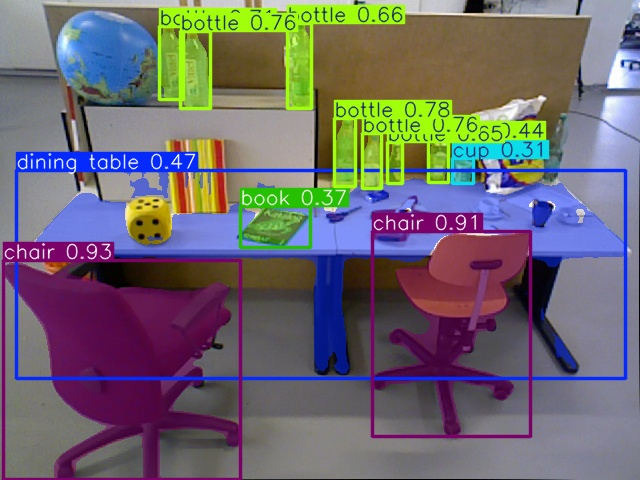

# 附加 RGB-D 几何练习

这些脚本保留为早期学习材料，主项目入口为训练、跟踪、评估和 ONNX 对照。

- yolo-3d1.py：中心像素与 5×5 邻域深度中位数，计算可见表面 XYZ。
- yolo-3d2.py：检测框点云。
- yolo-3d3.py：检测框、深度范围与掩码点云的同视角显示。
- yolo-3d4.py：分割掩码点云，并生成 chair_mask_cloud.ply。

安装：`python -m pip install -r requirements-rgbd.txt`。

脚本仍包含本地 Open3D 缓存路径 `D:\study\open3d_data`，使用前按自己的目录修改。需要本地图形桌面。权重路径以各脚本为准，不作为无配置即可运行的统一工具。

先从仓库根目录运行 yolo-3d4.py 生成 `chair_mask_cloud.ply`，再运行 yolo-3d3.py。其余根目录点云和图片输出不提交到 Git。

深度按 TUM 原始 PNG 的 5000 换算到米；内参 525/525/319.5/239.5 仅用于当前样例，不能套用到新数据集或不同分辨率。结果是可见表面，不是完整物体尺寸或 6D 位姿。

历史记录中手工反投影与 Open3D 同条件得到 227933 点，打印精度下坐标/颜色误差为零；这是样例数值一致性，不是多场景几何精度基准。详细历史记录见 [归档](LEGACY_EXPERIMENTS.md)。
